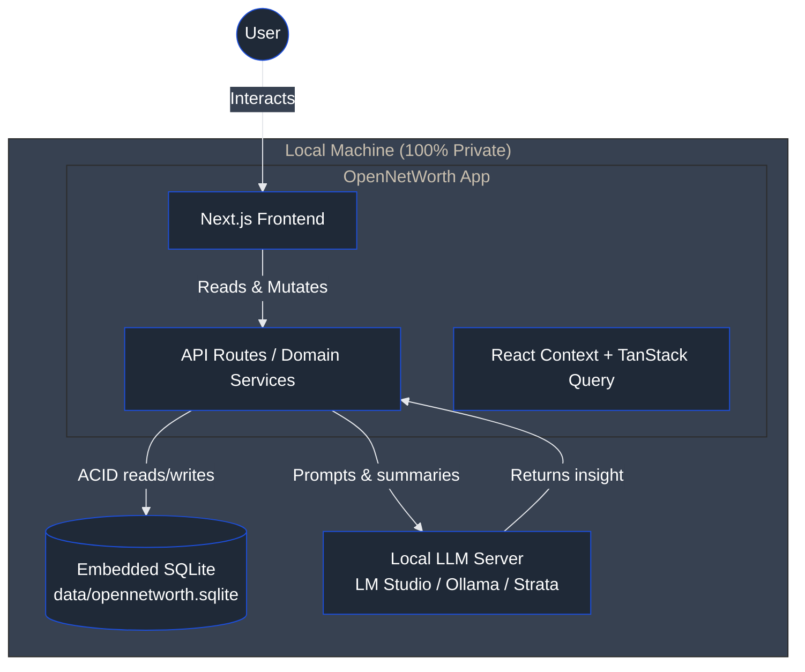
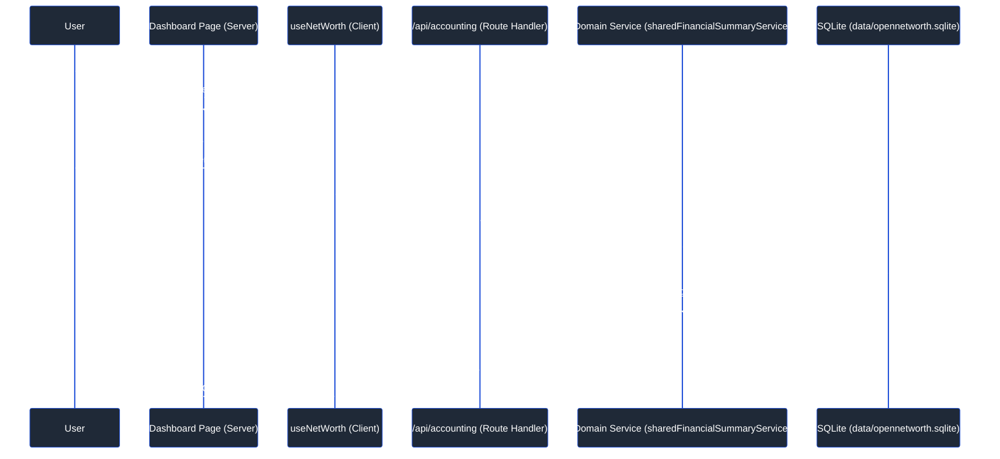

# OpenNetWorth Project Masterclass

Welcome to the **OpenNetWorth Project Masterclass**. This document is designed to take you from "knowing the code exists" to "understanding the architectural soul" of the application.

We chose this stack (Next.js, embedded SQLite, Local LLMs) not just because it's modern, but because it lets the entire application — storage, calculations, and AI — run on the user's own machine with zero cloud dependencies.

---

## 🏗️ Architecture Deep Dive

OpenNetWorth follows a **Sovereign, Local-First Monolith** pattern using Next.js App Router.
-   **Frontend**: React Server Components (RSC) for initial load, Client Components for interactivity.
-   **Backend**: Next.js API routes (`src/app/api/*`) for reads and mutations, embedded **SQLite** (`data/opennetworth.sqlite` via `better-sqlite3`) for persistence.
-   **AI**: Local LLM servers only — LM Studio (`:1234`), Ollama (`:11434`), or Strata (`:8080`) — with deterministic offline heuristic fallbacks when no LLM is running.

### System Context (C4 Container)

This diagram shows how the user interacts with the system. Everything runs on one machine — nothing sensitive leaves it.

---

## 🧠 Core Concepts & Best Practices

### 1. The "Service Pattern" in TypeScript
Instead of writing raw SQL inside our UI components or routes, we utilize a **Service Pattern**.
*   **Why?** It decouples the database logic from the view logic. All SQL lives behind domain services, so swapping storage engines means changing one layer, not hundreds of components.
*   **Example**: `src/lib/domain/accounting/` (`balanceService.ts`, `transactionService.ts`, `sharedFinancialSummaryService.ts`) sits on top of the connection layer in `src/infrastructure/sqlite/db.ts`.

### 2. Composition over Inheritance
In React, we prefer composing small components together rather than building massive "God Components".
*   **Why?** Reusability and clarity.
*   **Example**: `NetWorthChartWidget.tsx`. It acts as a container that fetches data and *composes* the `NetWorthChart` presentation component inside the `WidgetWrapper` container.

### 3. API Routes for Mutations
We use Next.js API routes (`src/app/api/accounting`, `/mentor`, `/vault`, `/documents`) for data updates.
*   **Why?** Mutations run server-side against the SQLite file with transactional guarantees, while the browser stays a thin, cacheable client. Types are shared end-to-end via `src/types` and domain interfaces.

### 4. Deterministic Fallbacks Everywhere
Every LLM-powered feature has a rule-based fallback path.
*   **Why?** The app must stay fully usable with no LLM server running, and financial parsing must be auditable. If the local model is down, intent parsing and mentorship degrade gracefully to heuristics — never to a cloud API.

---

## 🔍 Code Walkthrough

We have annotated several key files in the codebase with `// TUTORIAL:` comments to help you understand the specific implementation details.

### 1. The Data Layer (`src/infrastructure/sqlite/db.ts`)
This file owns the single embedded SQLite connection (WAL mode, migrations, prepared statements). Domain services in `src/lib/domain/accounting/` build the double-entry ledger (`m1_accounts`, `m1_transactions`, `m1_postings`) and the balance observation ledger on top of it.

### 2. The Presentation Layer (`src/features/dashboard/widgets/NetWorthChartWidget.tsx`)
This file shows how to build a dashboard widget. Notice the **Separation of Concerns**: the widget focuses on *data fetching* and *layout*, while delegating the actual *rendering* to the Chart component and the *styling* to the Wrapper component.

### 3. The AI Integration (`src/features/mentors/components/ChatInterface.tsx`)
This component is a pure **Presentational Component**. It takes in props and events, and outputs UI. It doesn't know *how* the AI answers are generated, it only knows *how to display* them. This makes it extremely easy to test or use in a Storybook. The actual model calls live in `src/lib/api/localLlm.ts`, which auto-detects LM Studio, Ollama, or Strata.

---

## 🔄 Data Flow: Fetching Dashboard Data

Here is exactly what happens when a user loads their dashboard.

---

## 🚀 Next Steps

To continue your learning journey:
1.  **Modify a Widget**: Try changing the `NetWorthChartWidget` to show a different time range by default.
2.  **Add a Service Method**: Add a `getTopAssets()` method to a domain service in `src/lib/domain/accounting/` and expose it through an API route.
3.  **Create a Mentor**: Duplicate an existing mentor in `src/features/mentors/data` and give them a new personality.
